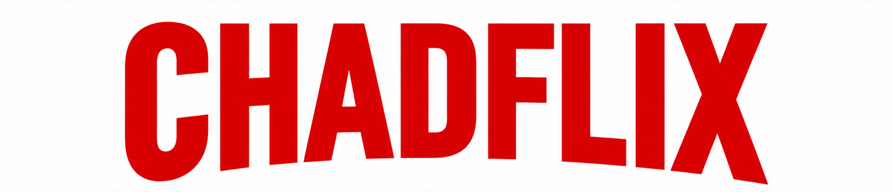
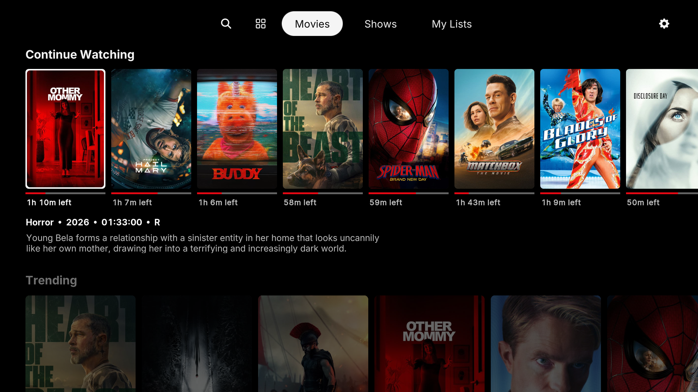
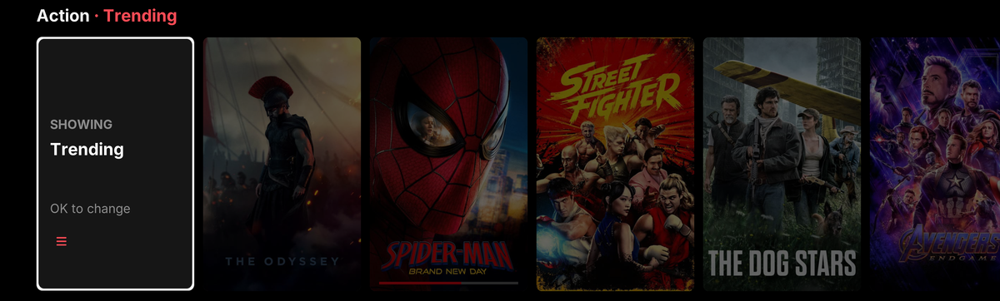
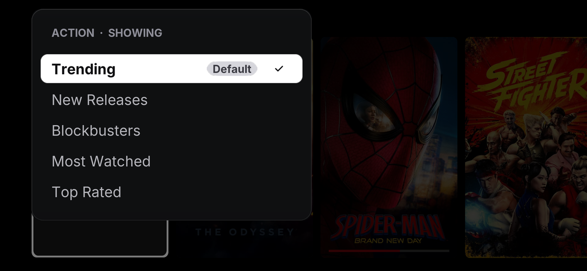
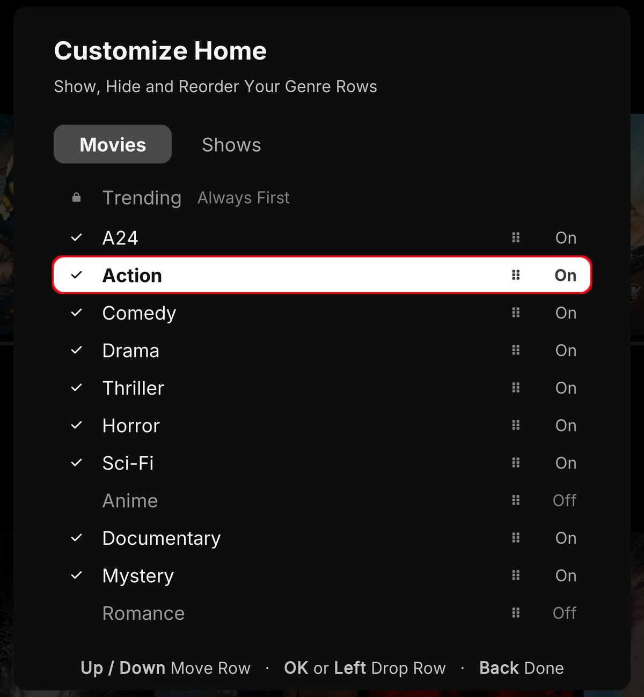
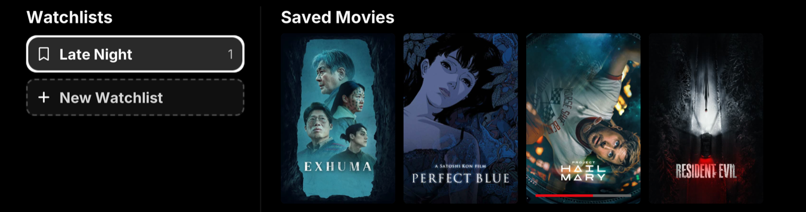
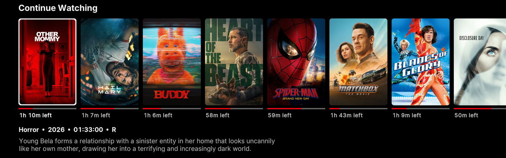
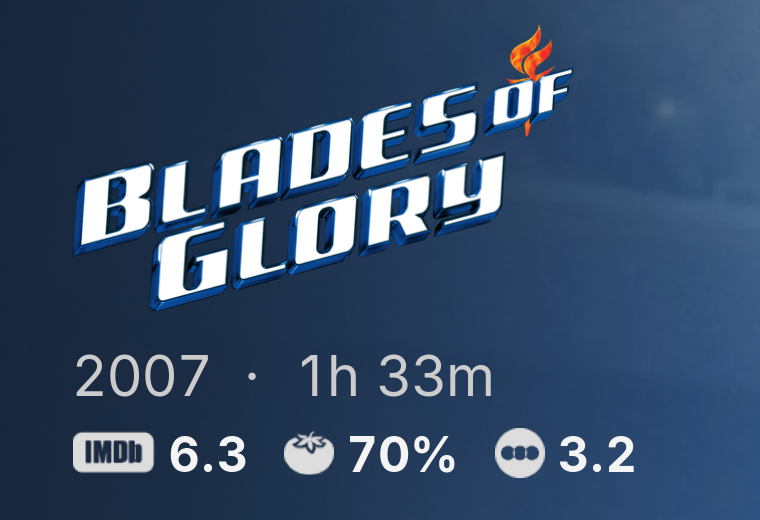
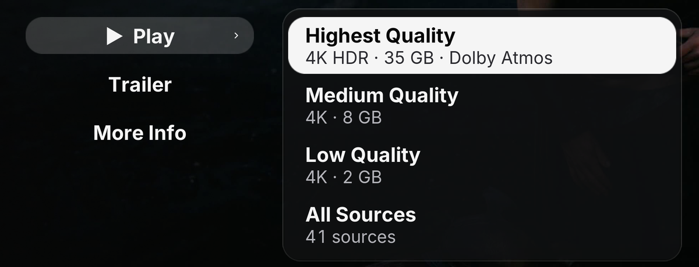
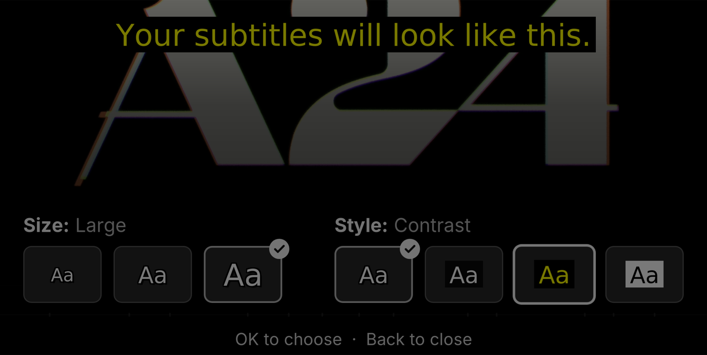

<div align="center">
  

  

  <h1>ChadFlix for Kodi</h1>

  <p>A (Better than) Netflix-style skin for Kodi 21.</p>

  <p>
    <a href="#features"><b>Features</b></a> ·
    <a href="#install"><b>Install</b></a> ·
    <a href="#signing-in">Signing In</a> ·
    <a href="#updating">Updating</a> ·
    <a href="#known-issues">Known Issues</a> ·
    <a href="#uninstall">Uninstall</a>
  </p>
</div>

An unofficial, modified build of the Arctic Fuse 3 skin and the POV add-on.

## Features

### Showing Tile

Each genre row can show a different list:

- **Movies**: Trending (Default), New Releases, Blockbusters, Most Watched, Top Rated.
- **Shows**: Trending (Default), New Series, Most Watched, Top Rated, Complete Series.

Each row keeps its choice, and its **More Titles** grid shows the same list.

<p> </p>

### Customizable Home Page

Choose which genre rows appear and in what order, separately for Movies and Shows. Rows that are off don't load, so
the home page opens faster.

<p align="center"></p>

### Watchlists

Save titles to as many named watchlists as you like. They appear in **My Lists** next to your saved movies and shows.
Press **Watchlist** again on a title's page to remove it.



### Continue Watching

The first row on Movies and Shows, with a progress bar and the time left or the next episode.



### Ratings

IMDb, Rotten Tomatoes and Letterboxd ratings on title pages. They need a free MDbList key ([Signing In](#signing-in)).

<p align="center"></p>

### Play and Quality

Play starts the best 4K source automatically (Dolby Vision or HDR first). Highest, Medium and Low Quality choices,
and the full source list, are one button away.

<p align="center"></p>

### Skip Intro

A Skip Intro button appears during an episode's intro.

<p align="center"></p>

### Subtitles

Subtitle size and style, with a live preview of how they'll look.

<p align="center"></p>

## Install

You need Kodi 21 and POV already installed, and your own **Real-Debrid** account.

> [!WARNING]
> Real-Debrid allows one IP address at a time. Streaming on two internet connections at once can get the account
> flagged.

In Kodi on the Shield (about 10 minutes, 240 MB). Source address for step 2:

```
https://PaulGitHitGub.github.io/ChadFlix-Kodi-Skin/
```

1. **Settings** → **System** → **Add-ons**: turn on **Unknown sources** (**Yes** on the warning) and set
   **Update official add-ons from** to **Any repositories**.
2. **Settings** → **File manager** → **Add source** → **&lt;None&gt;**: type the address exactly, **OK**, name it
   `chadflix`, **OK**.
3. **Settings** → **Add-ons** → **Install from zip file** → **chadflix** → **repository.chadflix-1.0.0.zip**.
   Wait for *add-on installed*.
4. Same screen: **Install from repository** → **ChadFlix Repository** → **Program add-ons** → **ChadFlix Setup** →
   **Install**. **OK** on the list of add-ons; **No** if Kodi offers to switch skin. Wait for *add-on installed*.
5. Home → **Add-ons** → **Program add-ons** → **ChadFlix Setup** → **Set up ChadFlix**. YouTube is optional. Choose
   **Switch** (the screen goes dark briefly; the setup answers "Keep skin?" itself), then **Close Kodi** and open it
   again.

Kodi opens on **Movies**. Next: [Signing In](#signing-in).

## Quick Start

| Button | What it does |
| --- | --- |
| Arrows | Move around the rows and the top bar |
| OK | Open a title, or play from its page |
| Right on **Play** (movies) | Quality choices and **All Sources** |
| Back while a video plays | Pauses and asks. Back again stops; OK keeps watching |

## Signing In

Open the **gear** (top right). Keys stay on your Shield.

| Row | What to do |
| --- | --- |
| **Real-Debrid** (required) | Select it, then enter the code Kodi shows at real-debrid.com/device, or scan the QR code. |
| **MDbList Key** (ratings) | Paste a free API key from mdblist.com (Preferences → API). |
| Trakt (optional) | Under Real-Debrid (POV's *My Services*), select **TRAKT**. |

## Updating

Kodi updates ChadFlix by itself (or **Add-ons** → **Check for updates**). **Restart Kodi once after an update**; no
need to run the setup again. Changes: [CHANGELOG.md](CHANGELOG.md).

> [!NOTE]
> The included POV is changed. Its version (6.99.x) is above POV's own, so POV updates can't overwrite it; POV fixes
> arrive only through here. Release 2 also turns POV's **Reuse Language Invoker** off once (it crashed on Android TV).
> To turn it back on: POV → Tools → Set Language Invoker.

## Security

Before this release, the published repository and every add-on zip were audited by an AI security review (Fable 5.2 & Astra). It found no passwords, tokens or personal sign-ins in the files and no telemetry. It also found issues that the next release fixes: POV's source checks keep their results, including playable links, on the device for a short time; POV's optional log upload and some sign-in steps can include service keys or links; and some network requests have no time limit.

ChadFlix is mostly a visual change: a reworked skin plus small changes to POV for the home rows and play button. It adds no new places your Shield connects to. Every connection uses HTTPS, so others on your network can't read it.

| Service | What it's for | What it receives |
| --- | --- | --- |
| TMDb (The Movie Database) | Posters, descriptions, genre lists | Which title or list is being shown. No account, no personal details. |
| Trakt | Trending, Most Watched and similar rows | Which public list is being loaded. Your watch history only if you choose to sign in to Trakt. |
| Your scrapers and Real-Debrid | Finding and playing sources (POV, unchanged) | The title being checked. Opening a movie page starts this check, so they see the titles you browse, not only the ones you play. |

TMDb and Trakt are the same services POV and TMDb Helper already used before ChadFlix.

As with any third-party Kodi repository, installing it means trusting its publisher with updates, and the install steps turn on Unknown sources and *Any repositories*. You can turn Unknown sources off again after installing.

## Known Issues

| Issue | What to do |
| --- | --- |
| Kodi can close by itself, usually after stopping a video. | Open it again; nothing is lost. |
| **More Titles** grids are slow on the first open each day. | Later opens are quicker. |
| Movies' Documentary, Mystery and Romance rows can be short on Trending. | Pick another list on the **Showing** tile. |
| Episodes may open POV's source list: they follow POV's **Auto Play** setting, off by default. | Turn on Auto Play (Episodes) in POV's playback settings. |

## Uninstall

In this order, so Back keeps working:

1. **ChadFlix Setup** → **Undo ChadFlix keymaps** (Home → **Add-ons** → **Program add-ons**).
2. **Settings** → **Interface** → **Skin** → **Skin** → **Estuary**, then **Yes**.
3. Optional: **Settings** → **Add-ons** → **My add-ons** → uninstall **Arctic Fuse 3**, **ChadFlix Setup** and
   **ChadFlix Repository**.
4. For POV's own version: uninstall **POV** (choose **No** to keep its data and sign-ins), then reinstall it from its
   official source.

## Troubleshooting

| Problem | Fix |
| --- | --- |
| No **chadflix** in **Install from zip file** | The address must end with `/`. Remove the source and add it again. |
| Step 4 fails | *Not available*: set **Any repositories** (step 1). *POV: Update failed*: restart Kodi, repeat step 4. |
| Old look after the setup | Restart Kodi and run step 5 again. |
| Nothing plays | Sign in to **Real-Debrid**; stop streaming on other connections. |
| No ratings | Add the **MDbList Key**. |
| A row is missing | Gear → **Customize Home**: it may be off. |
| Back does odd things | Open **ChadFlix Setup** once; it restores the remote-control files. |

---

Unofficial; not supported by the authors of Arctic Fuse 3, TMDb Helper or POV. Credits and licences:
[NOTICE.md](NOTICE.md).
